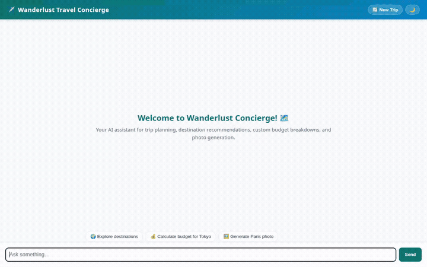

# Wanderlust Travel Concierge ✈️🌴

An intelligent, multimodal travel concierge agent built with Google's Agent Development Kit (**ADK**) and deployed on Vertex AI Agent Engine. Wanderlust Concierge helps travelers discover destination recommendations, calculate trip budgets, geocode landmarks, generate custom travel photography and video previews, and preserve user preferences across sessions.



---

## 🌟 Implemented Features & Architecture

### 1. Cross-Session Long-Term Memory (Vertex AI Memory Bank)
- **PreloadMemoryTool & Fact Extraction Callback**: Automatically remembers user travel preferences (budget level, preferred destinations, dietary restrictions, accommodation style) across separate chat sessions via Vertex AI Memory Bank.

### 2. Live Database Lookups (Google Cloud Firestore)
- **Destination Catalog Tool (`get_destinations_from_catalog`)**: Connects to Google Cloud Firestore (`wanderlust_destinations` collection) to retrieve real-time destination data, recommended activities, best seasons, and estimated daily costs.

### 3. Geocoding & Mapping (`geocode_address`)
- **Google Maps Geocoding API**: Translates street addresses, city names, or landmark queries into precise geographical coordinates (latitude and longitude) and standardized mailing addresses.

### 4. Travel Budget Estimator (`calculate_travel_budget`)
- **Budget Computation Tool**: Calculates itemized daily expenses (accommodation, food, activities, transportation) for a specified trip duration and destination.

### 5. Multimodal Media Generation & Cloud Storage
- **Imagen 3 Photo Generation (`generate_destination_image`)**: Uses `imagen-3.0-generate-002` to generate high-resolution travel photography.
- **Gemini Omni Video Generation (`generate_destination_video`)**: Uses `gemini-omni-flash-preview` in the `global` region to produce short travel video clips.
- **ADK Artifacts & Google Cloud Storage**: Generated photos and videos are saved as ADK session artifacts and uploaded directly to a public Cloud Storage bucket for streaming media URLs.

### 6. Rich A2UI Card Rendering
- **Structured UI Components**: Emits A2UI card schemas (`HeroCard`, `DestinationCard`, `BudgetCard`, `PhotoCard`, `VideoCard`) rendered natively by the frontend rather than plain markdown text.

---

## 🛠️ Google Cloud Services & Technologies Used

- **Agent Framework**: Google Agent Development Kit (**ADK**) (`google-adk`)
- **Primary Foundation Model**: `gemini-2.5-flash`
- **Memory Infrastructure**: Vertex AI Memory Bank (`PreloadMemoryTool`)
- **Database**: Google Cloud Firestore (`google-cloud-firestore`)
- **Media Models**: Imagen 3 (`imagen-3.0-generate-002`), Gemini Omni (`gemini-omni-flash-preview`)
- **Storage**: Google Cloud Storage (`google-cloud-storage`)
- **Location Services**: Google Maps Geocoding API (`googlemaps`)
- **Hosting**: Vertex AI Agent Engine (Reasoning Engine) + Cloud Run (FastAPI Chat Frontend)

---

## 🚀 Local Setup & Run Instructions

### Prerequisites
- Python 3.11+
- `uv` or `pip`
- Google Cloud SDK (`gcloud`) authenticated to your GCP project with `aiplatform.user` role.

### Environment Setup

Set required environment variables:
```bash
export PROJECT_ID="<YOUR_PROJECT_ID>"
export GOOGLE_MAPS_API_KEY="<YOUR_MAPS_KEY>"
```

### 1. Run Agent Locally with ADK Web UI

Install dependencies and start the local ADK dev playground:
```bash
pip install -r requirements.txt
adk web app
```
The playground interface will be available in your browser for testing tools and artifacts.

### 2. Run Custom Frontend Server Locally

To start the custom FastAPI chat proxy and frontend:
```bash
cd frontend
pip install -r requirements.txt
export AGENT_ENGINE_RESOURCE_NAME="projects/<PROJECT_NUM>/locations/us-east1/reasoningEngines/<ENGINE_ID>"
export AGENT_DIRECTORY="app"
python main.py
```
Open a browser to access the interactive single-page chat application.

### 3. Deploy to Production

#### Deploy Agent Engine to Vertex AI
```bash
agents-cli deploy agent-engine
```

#### Deploy Frontend to Cloud Run
```bash
cd frontend
gcloud run deploy wanderlust-concierge-frontend \
  --source . \
  --region us-east1 \
  --set-env-vars AGENT_ENGINE_RESOURCE_NAME="projects/<PROJECT_NUM>/locations/us-east1/reasoningEngines/<ENGINE_ID>",AGENT_DIRECTORY="app" \
  --allow-unauthenticated
```
